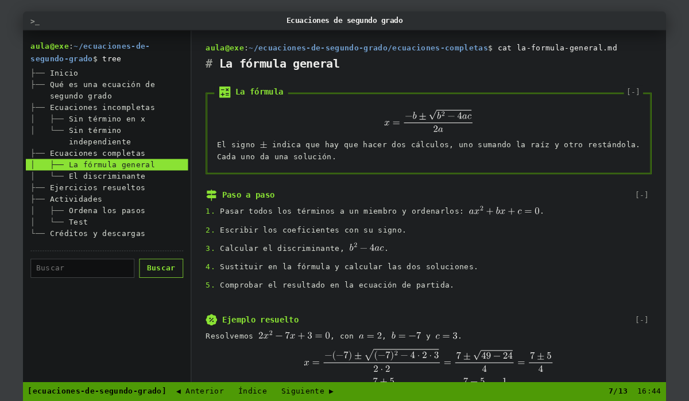

# Consola, estilo de eXeLearning

Estilo de [eXeLearning](https://exelearning.net/) 4.0.5 o posterior que presenta el recurso como una **terminal de Linux**: fondo oscuro, la paleta Tango de GNOME Terminal y la letra DejaVu Sans Mono. El índice es la salida de la orden `tree`, cada página se abre desde el prompt de bash con su ruta y una barra de estado como la de `tmux` lleva a la página anterior y a la siguiente.

El ejemplo que lo acompaña, **«Ecuaciones de segundo grado»**, tiene 13 páginas sobre la resolución de ecuaciones completas e incompletas, con ejemplos y ejercicios resueltos, una actividad de ordenar pasos y un test de diez preguntas. Todas las fórmulas están en LaTeX.



[Ejemplo publicado](https://jjdeharo.github.io/exelearning-style-consola/) · [Descargar el estilo](https://github.com/jjdeharo/exelearning-style-consola/releases/latest/download/consola.zip) · [Descargar el ejemplo](https://github.com/jjdeharo/exelearning-style-consola/releases/latest/download/ecuaciones-segundo-grado.elpx) · [Abrir el ejemplo en eXeLearning en línea](https://static.exelearning.dev/?url=https://github-proxy.exelearning.dev/?repo=jjdeharo/exelearning-style-consola&branch=main)

## Cómo usarlo

**Lo más sencillo: partir del ejemplo.** El archivo `ecuaciones-segundo-grado.elpx` lleva el estilo dentro. Al abrirlo en eXeLearning, el programa ofrece instalarlo. Después se sustituye el contenido del ejemplo por el propio, o se aplica el estilo, ya instalado, a otro proyecto.

**Instalar solo el estilo.** Se descarga `consola.zip` y, en eXeLearning, se importa desde el panel de estilos, en la pestaña de estilos importados.

## Cómo es

- **Ventana de terminal.** En pantallas anchas, una ventana sobre el escritorio, con el título del recurso en la barra de título. En el móvil ocupa toda la pantalla.
- **El índice como `tree`.** Las páginas aparecen con las ramas de la orden `tree` (`├──`, `└──`, `│`), y la abierta, en vídeo inverso. Debajo está el buscador del recurso. En el móvil, el índice se abre con el botón «Índice» de la barra inferior y se cierra con Escape.
- **El prompt de bash.** Cada página empieza con `aula@exe:~/recurso/carpeta$ cat página.md`, con la ruta que le corresponde en el árbol, y termina con el prompt y el cursor parpadeando, a la espera de la siguiente orden.
- **La barra de `tmux`.** Verde con texto negro: la sesión, «Anterior», «Índice», «Siguiente», el número de página y la hora.
- **Cajas.** Las de texto llevan el título en verde; las actividades se enmarcan con doble línea, como una ventana de `dialog`. Los botones son texto verde enmarcado, como `[ Comprobar ]`.
- **Sin JavaScript o al imprimir**, el contenido se lee como una página normal. Al imprimir, en tinta oscura sobre papel blanco.

### Clases para las cajas

Se escriben en el campo «Clase CSS» de las propiedades de la caja:

| Clase | Efecto |
|---|---|
| `cli-ok` | `[  OK  ]` en verde delante del título, como en el arranque de systemd |
| `cli-info` | `[ INFO ]` en azul |
| `cli-warn` | `[ WARN ]` en amarillo |
| `cli-fail` | `[FAILED]` en rojo |
| `cli-marco` | marco de doble línea, como el de las actividades |

Las cuatro etiquetas ponen además una línea de su color a la izquierda del contenido. Se pueden combinar con `cli-marco`: `cli-ok cli-marco` enmarca la caja en verde.

### Fórmulas

Las fórmulas se escriben en LaTeX, con `\( … \)` dentro del texto y `\[ … \]` en línea aparte. eXeLearning las dibuja al exportar y el estilo les da el color del texto.

## Organización del repositorio

La raíz es el ejemplo exportado y descomprimido: se publica tal cual en GitHub Pages y se puede abrir en eXeLearning.

| Ruta | Qué es |
|---|---|
| `theme/` | El estilo: `config.xml`, `style.css`, `style.js`, la miniatura, la tipografía (`fonts/`) y los iconos de los iDevices (`icons/`) |
| `content.xml`, `content.dtd` | El proyecto de eXeLearning del ejemplo |
| `index.html`, `html/`, `libs/`, `idevices/`, `content/`, `search_index.js` | El ejemplo exportado por eXeLearning |
| `edit-in-exelearning.js` | Enlace «Editar en eXeLearning» del ejemplo publicado; no forma parte del estilo |
| `scripts/ejemplo.py` | El contenido del ejemplo: páginas, cajas, fórmulas y actividades |
| `scripts/construir_ejemplo.py` | Escribe `content.xml` y exporta el ejemplo con la orden de línea de eXeLearning |
| `scripts/mathml.cjs` | Añade el MathML de cada fórmula para los lectores de pantalla |
| `scripts/empaquetar.py` | Construye `dist/consola.zip` y `dist/ecuaciones-segundo-grado.elpx` |
| `scripts/comprobar.py` | Comprueba metadatos, referencias, fórmulas y paquetes |
| `scripts/comprobar-navegador.cjs` | Recorre el ejemplo en el navegador: árbol, prompt, barra, soluciones, actividades y móvil |
| `scripts/accesibilidad.cjs` | Revisa la accesibilidad de cada página con axe-core |
| `docs/adr/` | Registro de decisiones |
| `.github/workflows/release.yml` | Publica los paquetes al subir una etiqueta `v*` |

## Construir y comprobar

```sh
# El ejemplo, desde scripts/ejemplo.py (hace falta una copia de eXeLearning con dist/cli.js y bun)
python3 scripts/construir_ejemplo.py /ruta/a/exelearning
# Los paquetes y las comprobaciones
python3 scripts/empaquetar.py
python3 scripts/comprobar.py
python3 -m http.server 1315 --bind 127.0.0.1
NODE_PATH=$(npm root -g) node scripts/comprobar-navegador.cjs http://localhost:1315/ chromium   # también firefox y webkit
NODE_PATH=$(npm root -g) node scripts/accesibilidad.cjs http://localhost:1315/
```

Para regenerar la miniatura del estilo, se añade `CAPTURA=theme/screenshot.png,screenshot.png,.github/screenshot.png` delante de la comprobación en el navegador y se vuelve a empaquetar.

Si el ejemplo se edita en eXeLearning, el `content.xml` guardado pasa a ser la fuente y `scripts/ejemplo.py` queda como el punto de partida.

## Créditos y licencias

- **Estilo** (`theme/style.css`, `theme/style.js`, `theme/config.xml`) y scripts: [GNU AGPL v3 o posterior](LICENSE), la misma licencia que eXeLearning. Juan José de Haro.
- **Recurso de ejemplo** «Ecuaciones de segundo grado»: [CC BY-SA 4.0](LICENSE-CONTENIDOS). Juan José de Haro.
- **DejaVu Sans Mono**, del [proyecto DejaVu](https://dejavu-fonts.github.io/), reducida a WOFF2 con los caracteres latinos, los signos matemáticos y los de dibujo de cajas: licencia de Bitstream Vera, con los cambios de DejaVu en dominio público ([texto completo](theme/fonts/LICENSE.txt)).
- **Iconos de los iDevices**: [Material Symbols](https://fonts.google.com/icons) de Google, tomados del estilo Zen de eXeLearning y coloreados en verde, bajo la [Apache License 2.0](theme/icons/LICENSE.txt).
- **Colores**: la paleta del [proyecto Tango](https://en.wikipedia.org/wiki/Tango_Desktop_Project).
- La idea y la organización del repositorio siguen los estilos de eXeLearning del [Área de Tecnología Educativa del Gobierno de Canarias](https://github.com/ateeducacion), de Ernesto Serrano, como [eXeTexto](https://github.com/ateeducacion/exelearning-style-teletext).
- Los archivos de eXeLearning y sus bibliotecas (`libs/`, `idevices/`, `content/css/`) conservan sus licencias.

Estilo y ejemplo hechos con Claude Code (Anthropic) en octubre de 2026, con la dirección y la revisión de su autor: [nivel 4 del MIAE, cocreación](https://jjdeharo.github.io/miae/?nivel=4).
