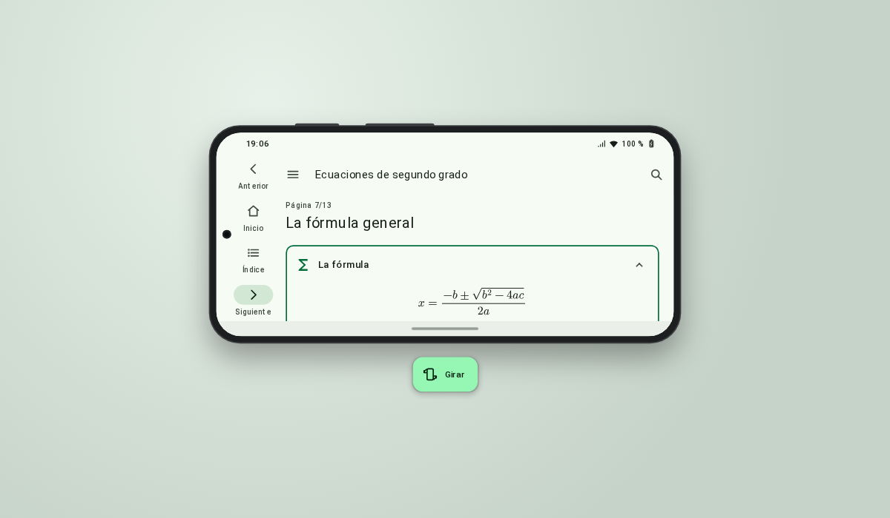

# Android, estilo de eXeLearning

Estilo de [eXeLearning](https://exelearning.net/) 4.0.5 o posterior que presenta el recurso como una **aplicación en un móvil Android**, con Material Design 3 y la letra Roboto. En el ordenador, el móvil se dibuja sobre el escritorio y se puede **girar entre vertical y horizontal**; en un móvil de verdad, ocupa toda la pantalla.

El ejemplo es el mismo que el del estilo [Consola](../consola/): **«Ecuaciones de segundo grado»**, 13 páginas con ejemplos y ejercicios resueltos, una actividad de ordenar pasos y un test, con las fórmulas en LaTeX.



[Ejemplo publicado](https://jjdeharo.github.io/exelearning-estilos/android/) · [Descargar el estilo](https://jjdeharo.github.io/exelearning-estilos/android/descargas/android.zip) · [Descargar el ejemplo](https://jjdeharo.github.io/exelearning-estilos/android/descargas/ecuaciones-segundo-grado.elpx)

## Cómo usarlo

**Lo más sencillo: partir del ejemplo.** El archivo `ecuaciones-segundo-grado.elpx` lleva el estilo dentro. Al abrirlo en eXeLearning, el programa ofrece instalarlo. Después se sustituye el contenido del ejemplo por el propio, o se aplica el estilo, ya instalado, a otro proyecto.

**Instalar solo el estilo.** Se descarga `android.zip` y, en eXeLearning, se importa desde el panel de estilos, en la pestaña de estilos importados.

## Cómo es

- **Barra superior**: el botón de menú abre el índice, el nombre del recurso y la lupa, que abre el buscador de eXeLearning.
- **Índice en un cajón** lateral, con la página abierta resaltada. Se cierra con Escape, con su botón o pulsando fuera.
- **Tarjetas**: cada caja es una tarjeta de Material, con el icono en verde y el botón de plegar. Las actividades van en tarjetas rellenas.
- **Barra de navegación** abajo, con Anterior, Inicio, Índice y Siguiente. En horizontal pasa a ser un raíl a la izquierda, como en Android, para dejar alto a la página.
- **El móvil dibujado**, en pantallas de al menos 800 × 608 px: cuerpo, cámara, botones laterales, barra de estado y barra de gestos.
- **La barra de estado es real**: la hora; el wifi, tachado si no hay conexión; la cobertura según la velocidad de la conexión, si el navegador la da; y la batería con su nivel y si se está cargando, en los navegadores que la dan (Chrome, Edge; en los demás, llena).
- **El botón de encendido**, el de arriba del lateral, apaga la pantalla y deja la hora, la fecha y la batería, como la pantalla siempre activa de Android. Se enciende pulsándolo otra vez o tocando la pantalla. El botón «Girar», junto al móvil, lo pone en horizontal o en vertical, con el mismo tamaño, como un móvil de verdad, con una animación (sin ella si el sistema pide reducir el movimiento), y la orientación elegida se recuerda en el navegador.
- **Tema claro u oscuro**, el que tenga el sistema, con un esquema de color de Material Design 3 a partir del verde de Android.
- **Sin JavaScript o al imprimir**, el contenido se lee como una página normal.

### Clases para las cajas

Se escriben en el campo «Clase CSS» de las propiedades de la caja:

| Clase | Efecto |
|---|---|
| `md-ok` | tarjeta verde, el contenedor principal |
| `md-info` | tarjeta azul verdosa, el contenedor terciario |
| `md-warn` | tarjeta ámbar, para avisos |
| `md-error` | tarjeta roja, el contenedor de error |
| `md-highlight` | tarjeta enmarcada con el color principal |

### Fórmulas

En LaTeX, con `\( … \)` dentro del texto y `\[ … \]` en línea aparte, y «Añadir MathJax» activado en las propiedades del proyecto: las dibuja el MathJax de eXeLearning.

## Organización de esta carpeta

| Ruta | Qué es |
|---|---|
| `theme/` | El estilo: `config.xml`, `style.css`, `style.js`, la miniatura y la tipografía (`fonts/`). Los iconos de las cajas son los de eXeLearning |
| `content.xml`, `index.html`, `html/`, `libs/`, `idevices/`, `content/`, `search_index.js` | El ejemplo, guardado por el editor de eXeLearning y exportado por su orden de línea |
| `scripts/estilo.py` | Lo propio de este estilo en el ejemplo común: presentación, cómo moverse, clases y créditos |
| `scripts/comprobar-navegador.cjs` | Recorre el ejemplo en el navegador: móvil dibujado, navegación, índice, búsqueda, giro, actividades y móvil de verdad |
| `docs/adr/` | Registro de decisiones del estilo |

El contenido del ejemplo y las herramientas de construcción son comunes a los estilos: están en `ejemplos/` y `herramientas/`, en la raíz del repositorio.

## Construir y comprobar

Desde la raíz del repositorio:

```sh
NODE_PATH=$(npm root -g) python3 herramientas/construir_ejemplo.py android /ruta/a/exelearning
python3 herramientas/empaquetar.py android
python3 herramientas/comprobar.py android
python3 -m http.server 8080
NODE_PATH=$(npm root -g) node android/scripts/comprobar-navegador.cjs http://localhost:8080/android/ chromium   # también firefox y webkit
NODE_PATH=$(npm root -g) node herramientas/accesibilidad.cjs http://localhost:8080/android/
```

## Créditos y licencias

- **Estilo** (`theme/style.css`, `theme/style.js`, `theme/config.xml`): [GNU AGPL v3 o posterior](../LICENSE), la misma licencia que eXeLearning. Juan José de Haro.
- **Recurso de ejemplo** «Ecuaciones de segundo grado»: [CC BY-SA 4.0](../LICENSE-CONTENIDOS). Juan José de Haro.
- **Roboto**, de Google ([fonts-roboto](https://github.com/googlefonts/roboto), paquete de Debian), reducida a WOFF2 con los caracteres latinos y los signos matemáticos: [Apache License 2.0](theme/fonts/LICENSE.txt).
- **Diseño**: las pautas de [Material Design 3](https://m3.material.io/), con un esquema de color propio a partir del verde de Android. Los iconos de la interfaz (menú, lupa, flechas, casa, lista, girar, barra de estado) están dibujados para el estilo con trazos sencillos.
- **Iconos de las cajas** y **fórmulas**: los de eXeLearning (Material Symbols de Google y MathJax).
- Android es una marca de Google LLC. Este estilo solo imita su aspecto; no es un producto de Google.

Estilo y ejemplo hechos con Claude Code (Anthropic) en octubre de 2026, con la dirección y la revisión de su autor: [nivel 4 del MIAE, cocreación](https://jjdeharo.github.io/miae/?nivel=4).
