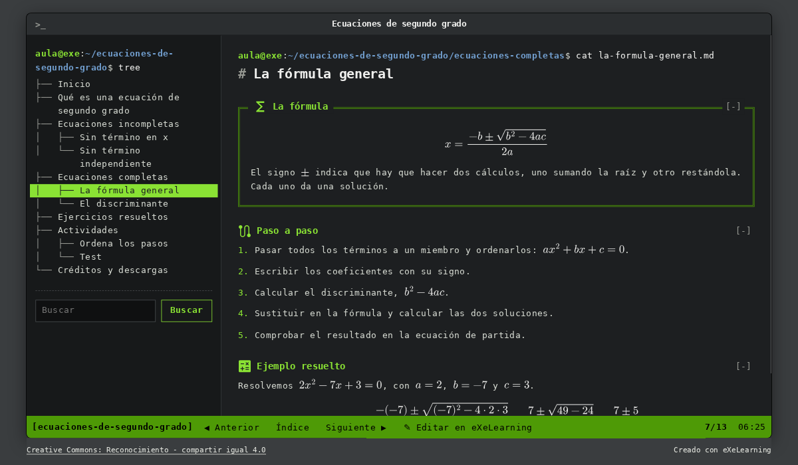

# Consola, estilo de eXeLearning

Estilo de [eXeLearning](https://exelearning.net/) 4.0.5 o posterior que presenta el recurso como una **terminal de Linux**: fondo oscuro, la paleta Tango de GNOME Terminal y la letra DejaVu Sans Mono. El índice es la salida de la orden `tree`, cada página se abre desde el prompt de bash con su ruta y una barra de estado como la de `tmux` lleva a la página anterior y a la siguiente.

El ejemplo que lo acompaña, **«Ecuaciones de segundo grado»**, tiene 13 páginas sobre la resolución de ecuaciones completas e incompletas, con ejemplos y ejercicios resueltos, una actividad de ordenar pasos y un test de diez preguntas. Todas las fórmulas están en LaTeX.



[Ejemplo publicado](https://jjdeharo.github.io/exelearning-estilos/consola/) · [Descargar el estilo](https://jjdeharo.github.io/exelearning-estilos/consola/descargas/consola.zip) · [Descargar el ejemplo](https://jjdeharo.github.io/exelearning-estilos/consola/descargas/ecuaciones-segundo-grado.elpx) · [Abrir el ejemplo en eXeLearning en línea](https://static.exelearning.dev/?url=https://jjdeharo.github.io/exelearning-estilos/consola/descargas/ecuaciones-segundo-grado.elpx)

## Cómo usarlo

**Lo más sencillo: partir del ejemplo.** La barra de tmux del ejemplo publicado lleva además «✎ Editar en eXeLearning», que lo abre en eXeLearning en línea. También se puede descargar: el archivo `ecuaciones-segundo-grado.elpx` lleva el estilo dentro. Al abrirlo en eXeLearning, el programa ofrece instalarlo. Después se sustituye el contenido del ejemplo por el propio, o se aplica el estilo, ya instalado, a otro proyecto.

**Instalar solo el estilo.** Se descarga `consola.zip` y, en eXeLearning, se importa desde el panel de estilos, en la pestaña de estilos importados.

## Cómo es

- **Ventana de terminal.** En pantallas anchas, una ventana de medidas fijas sobre el escritorio, con el título del recurso en la barra de título; el índice y la página se desplazan dentro de ella, cada uno con su barra. En el móvil ocupa toda la pantalla.
- **El índice como `tree`.** Las páginas aparecen con las ramas de la orden `tree` (`├──`, `└──`, `│`), y la abierta, en vídeo inverso. Debajo está el buscador del recurso. En el móvil, el índice se abre con el botón «Índice» de la barra inferior y se cierra con Escape.
- **El prompt de bash.** Cada página empieza con `aula@exe:~/recurso/carpeta$ cat página.md`, con la ruta que le corresponde en el árbol. Una página con subpáginas es una carpeta, y su contenido, el `README.md` de esa carpeta.
- **Una terminal que funciona.** Al final de cada página, el prompt espera una orden:

  | Orden | Qué hace |
  |---|---|
  | `ls` | lista las páginas de la carpeta, con enlaces: las carpetas en azul y con `/` |
  | `cd PÁGINA` | abre una página; admite rutas (`cd ../actividades/test`), `cd ..` sube un nivel y `cd` vuelve al inicio |
  | `grep PALABRA` | busca en todo el recurso con el buscador de eXeLearning |
  | `plot FUNCIÓN` | dibuja la gráfica con caracteres, como gnuplot: `plot [-3:5] x^2-2x-3`; marca los cortes con el eje X y los dice con números debajo |
  | `calc EXPRESIÓN` | calcula: `calc 2*5^2-50` |
  | `clear` | borra la terminal |
  | `help` | explica las órdenes; `help ORDEN` u `ORDEN --help`, cómo se usa cada una |

  `plot` y `calc` se escriben como en la calculadora: `x^2` (o `x**2`), `2x`, `sqrt`, `abs`, `sin`, `cos`, `tan`, `ln`, `log` (decimal), `exp` y `pi`. Las flechas ↑ y ↓ recuperan las órdenes anteriores, también tras cambiar de página. El tabulador completa el nombre de una orden o de una página; con la línea vacía, pasa al siguiente control, como en el resto de la página. Las respuestas se anuncian a los lectores de pantalla.
- **La barra de `tmux`.** Verde con texto negro: la sesión, «Anterior», «Índice», «Siguiente», el número de página y la hora.
- **Cajas.** Las de texto llevan el título en verde; las actividades se enmarcan con doble línea, como una ventana de `dialog`. Los botones son texto verde enmarcado, como `[ Comprobar ]`.
- **Sin JavaScript o al imprimir**, el contenido se lee como una página normal. Al imprimir, en tinta oscura sobre papel blanco.

### Clases para las cajas

Se escriben en el campo «Clase CSS» de las propiedades de la caja:

| Clase | Efecto |
|---|---|
| `cli-ok` | `[  OK  ]` en verde delante del título, como en el arranque de systemd |
| `cli-info` | `[ INFO ]` en azul |
| `cli-warn` | `[ WARN ]` en amarillo |
| `cli-fail` | `[FAILED]` en rojo |
| `cli-marco` | marco de doble línea, como el de las actividades |

Las cuatro etiquetas ponen además una línea de su color a la izquierda del contenido. Se pueden combinar con `cli-marco`: `cli-ok cli-marco` enmarca la caja en verde.

### Fórmulas

Las fórmulas se escriben en LaTeX, con `\( … \)` dentro del texto y `\[ … \]` en línea aparte, y se activa «Añadir MathJax» en las propiedades del proyecto: las dibuja el MathJax de eXeLearning, y el estilo les da el color del texto.

## Organización del repositorio

Esta carpeta es una de las del repositorio [exelearning-estilos](../README.md). Su raíz es el ejemplo exportado y descomprimido: se publica tal cual en GitHub Pages, con los paquetes en `descargas/`, y su `.elpx` se puede abrir en eXeLearning.

| Ruta | Qué es |
|---|---|
| `theme/` | El estilo: `config.xml`, `style.css`, `style.js`, la miniatura y la tipografía (`fonts/`). Los iconos de las cajas son los de eXeLearning |
| `content.xml`, `content.dtd` | El proyecto de eXeLearning del ejemplo |
| `index.html`, `html/`, `libs/`, `idevices/`, `content/`, `search_index.js` | El ejemplo exportado por eXeLearning |
| `edit-in-exelearning.js` | «Editar en eXeLearning» del ejemplo publicado; no forma parte del estilo |
| `scripts/estilo.py` | Lo propio de este estilo en el ejemplo común: presentación, cómo moverse, clases y créditos |
| `scripts/comprobar-navegador.cjs` | Recorre el ejemplo en el navegador: árbol, prompt, barra, terminal, soluciones, actividades y móvil |
| `docs/adr/` | Registro de decisiones |

## Construir y comprobar

El contenido del ejemplo (`ejemplos/`) y las herramientas (`herramientas/`) son comunes a los estilos y están en la raíz del repositorio. Desde allí:

```sh
# Hace falta una copia de eXeLearning con `bun run build:static` hecho y Playwright
NODE_PATH=$(npm root -g) python3 herramientas/construir_ejemplo.py consola /ruta/a/exelearning
python3 herramientas/empaquetar.py consola
python3 herramientas/comprobar.py consola
python3 -m http.server 8080
NODE_PATH=$(npm root -g) node consola/scripts/comprobar-navegador.cjs http://localhost:8080/consola/ chromium   # también firefox y webkit
NODE_PATH=$(npm root -g) node herramientas/accesibilidad.cjs http://localhost:8080/consola/
```

Para regenerar la miniatura del estilo, se añade `CAPTURA=theme/screenshot.png,screenshot.png,captura.png` delante de la comprobación en el navegador, ejecutada desde `consola/`, y se vuelve a empaquetar.

## Créditos y licencias

- **Estilo** (`theme/style.css`, `theme/style.js`, `theme/config.xml`) y scripts: [GNU AGPL v3 o posterior](../LICENSE), la misma licencia que eXeLearning. Juan José de Haro.
- **Recurso de ejemplo** «Ecuaciones de segundo grado»: [CC BY-SA 4.0](../LICENSE-CONTENIDOS). Juan José de Haro.
- **DejaVu Sans Mono**, del [proyecto DejaVu](https://dejavu-fonts.github.io/), reducida a WOFF2 con los caracteres latinos, los signos matemáticos y los de dibujo de cajas: licencia de Bitstream Vera, con los cambios de DejaVu en dominio público ([texto completo](theme/fonts/LICENSE.txt)).
- **Iconos de las cajas**: los generales de eXeLearning ([Material Symbols](https://fonts.google.com/icons) de Google); el estilo los pinta de verde.
- **Fórmulas**: el MathJax que incluye eXeLearning.
- **Colores**: la paleta del [proyecto Tango](https://en.wikipedia.org/wiki/Tango_Desktop_Project).
- La idea y la organización del repositorio siguen los estilos de eXeLearning del [Área de Tecnología Educativa del Gobierno de Canarias](https://github.com/ateeducacion), de Ernesto Serrano, como [eXeTexto](https://github.com/ateeducacion/exelearning-style-teletext).
- Los archivos de eXeLearning y sus bibliotecas (`libs/`, `idevices/`, `content/css/`) conservan sus licencias.

Estilo y ejemplo hechos con Claude Code (Anthropic) en octubre de 2026, con la dirección y la revisión de su autor: [nivel 4 del MIAE, cocreación](https://jjdeharo.github.io/miae/?nivel=4).
